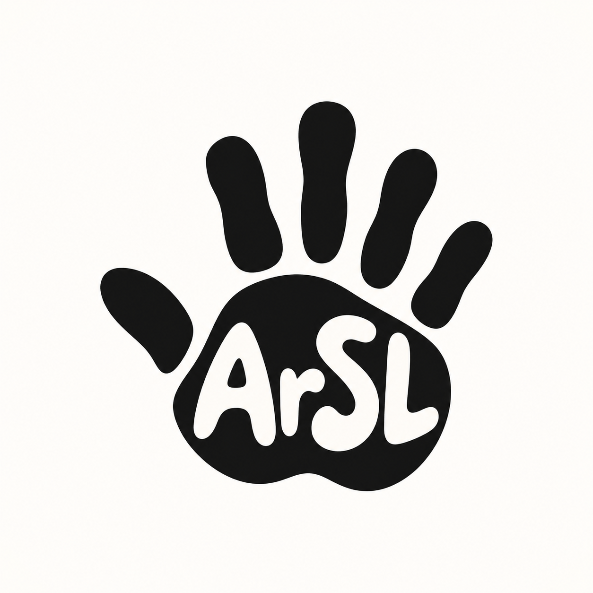

<p align="center">
  
</p>

<h1 align="center">Arabic Sign Language (ArSL) Letter Recognition</h1>

<p align="center">
  A Windows desktop app that recognizes isolated Arabic Sign Language alphabet signs from a webcam and helps users build written Arabic words letter by letter.
</p>

<p align="center">
  <a href="https://github.com/leasgit/arsl-sign-language-recognition/releases/latest/download/ArSL_Sign_Recognition_Setup.exe"><strong>⬇ Download for Windows</strong></a>
  &nbsp;•&nbsp;
  <a href="https://github.com/leasgit/arsl-sign-language-recognition/releases/latest">Latest release</a>
  &nbsp;•&nbsp;
  <a href="Project_Report.md">Project report</a>
</p>

<p align="center">
  
  
  
</p>

---

## Try the app

The easiest way to use the project is the Windows installer. **No Python setup or model training is required.**

1. **[Download the latest Windows installer](https://github.com/leasgit/arsl-sign-language-recognition/releases/latest/download/ArSL_Sign_Recognition_Setup.exe).**
2. Double-click `ArSL_Sign_Recognition_Setup.exe` and follow the setup wizard.
3. Optionally create a desktop shortcut during installation.
4. Open **ArSL Sign Recognition** from the Start Menu or desktop.
5. Allow camera access if Windows asks for permission.

The application shows a short loading screen while the recognition model starts, then opens the live webcam interface. The interface can be switched between **English and Arabic**.

> The current installer is unsigned, so Windows SmartScreen may display an unrecognized-app warning on some computers.

## For best recognition

Current live testing shows the most reliable predictions when you:

- use a **white or plain light background** behind the hand;
- use **good, even lighting** so the hand is clearly visible;
- keep the **full hand visible and reasonably centered** in the camera view.

## Features

- Live webcam recognition of **32 Arabic Sign Language alphabet classes**.
- Displays the detected Arabic letter and confidence score.
- Builds written Arabic words using **Add Letter**, **Delete**, and **Clear** controls.
- Manual written-form selection for variants such as `ا / أ / إ / آ`, `و / ؤ`, and `ي / ئ`.
- English and Arabic interface modes.
- Local camera processing — recognition does not require a cloud service.
- Windows installer with Start Menu integration and optional desktop shortcut.

## How it works

The application combines two components:

1. **MediaPipe Hand Landmarker** detects the hand and defines the crop used for recognition.
2. A custom **convolutional neural network (CNN)** classifies the cropped hand image into one of the 32 ArSL alphabet classes.

The CNN was trained on the **ArSL2018** dataset. The desktop application then connects the trained model to a webcam interface built with **PySide6** and **OpenCV**.

## Model results

| Metric | Value |
|---|---:|
| Test accuracy | **96.78%** |
| Test loss | 0.1403 |
| Macro-average precision / recall / F1 | 0.968 |
| Controlled live evaluation | 32/32 classes recognized top-1 |

The packaged application has also been tested successfully on a separate Windows laptop without relying on the development environment. Recognition worked correctly during that clean-machine test.

The controlled live result above is not a guarantee of performance for every signer or environment. See [`Project_Report.md`](Project_Report.md) for the full methodology, evaluation, and discussion.

## Important limitations

This is an **isolated-letter recognition prototype**, not a complete Arabic Sign Language translator.

- It recognizes one alphabet sign at a time; it does not recognize continuous signing, full words, grammar, facial expressions, or sentences.
- Accuracy can vary with lighting, camera quality, background, hand position, distance, and signer differences.
- Recognition is currently most reliable with a white/plain light background and good lighting.
- The model was trained on still images from ArSL2018, so real webcam conditions can differ from the training data.
- Some written Arabic forms cannot be determined from the hand sign alone. For example, an alef sign may need to be written as `ا`, `أ`, `إ`, or `آ`; the user therefore selects the intended written form in the interface.
- Dataset/test accuracy should not be interpreted as guaranteed real-world accuracy.
- Further testing with Arabic Sign Language users and NGO staff is recommended before broader deployment.

## Project structure

| File | Purpose |
|---|---|
| `app.py` | PySide6 desktop interface, bilingual UI, webcam display, word builder, and written-form selector |
| `recognition.py` | MediaPipe hand detection and CNN inference pipeline |
| `run_app.py` | App entry point, loading screen, and packaged-resource handling |
| `ArSL_Sign_Language_Recognition.ipynb` | CNN training and evaluation notebook |
| `webcam_arsl_demo.py` | Original development webcam demo |
| `Project_Report.md` | Detailed project methodology and evaluation |
| `build_windows.ps1` | Builds the standalone Windows application with PyInstaller |
| `installer.iss` | Inno Setup configuration |
| `build_installer.ps1` | Builds the final Windows installer |

<details>
<summary><strong>Run from source</strong></summary>

The trained CNN file and MediaPipe hand-landmarker file are not stored in the repository because they are large binaries.

### 1. Install runtime dependencies

```bash
pip install -r requirements.txt
```

### 2. Add the required model files

Place these files in the repository root:

```text
arsl_cnn_model.keras
hand_landmarker.task
```

The MediaPipe hand-landmarker model can be downloaded from:

https://storage.googleapis.com/mediapipe-models/hand_landmarker/hand_landmarker/float16/1/hand_landmarker.task

### 3. Start the desktop app

```bash
python run_app.py
```

</details>

<details>
<summary><strong>Train the CNN</strong></summary>

The dataset is not included in this repository. Download ArSL2018 from Mendeley Data:

https://data.mendeley.com/datasets/y7pckrw6z2/1

Expected folder structure:

```text
ArASL_Database_54K_Final/
└── ArASL_Database_54K_Final/
    └── <letter>/
        └── *.jpg
```

Install the training dependencies:

```bash
pip install -r requirements-training.txt
```

Then open `ArSL_Sign_Language_Recognition.ipynb` and run the notebook. It saves the trained model as `arsl_cnn_model.keras`.

</details>

<details>
<summary><strong>Build the Windows app and installer</strong></summary>

With the model files present in the repository root, build the standalone application:

```powershell
.\build_windows.ps1
```

The application is created under:

```text
dist\ArSL Sign Recognition\
```

Install Inno Setup 6, then build the installer:

```powershell
.\build_installer.ps1
```

The distributable installer is created at:

```text
installer_output\ArSL_Sign_Recognition_Setup.exe
```

Before publishing a new release, test the installer on a separate Windows computer that does not have Python installed.

</details>

## Privacy

Webcam frames are processed locally on the user's computer by MediaPipe and the CNN model. The packaged desktop application does not require a cloud recognition service for inference.

## Dataset citation

Latif, G., Alghazo, J., Mohammad, N., AlKhalaf, R., & AlKhalaf, R. (2019). *ArSL2018: Arabic Sign Language dataset for Arabic sign language recognition*. Mendeley Data. https://data.mendeley.com/datasets/y7pckrw6z2/1
